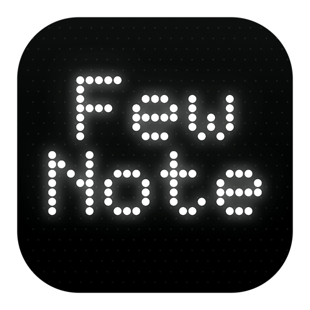
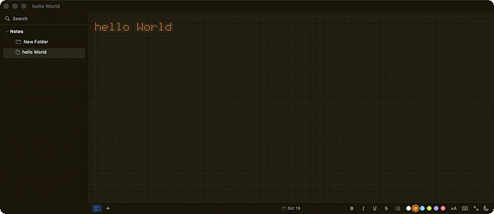
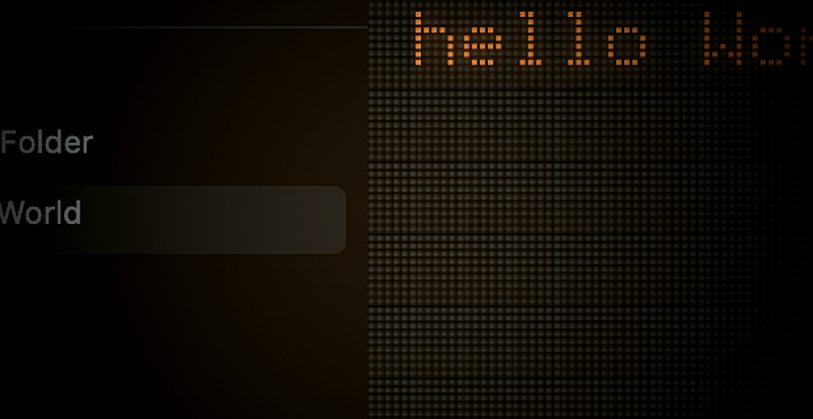

<div align="center">



# FewNote

**An ultra-lightweight, native macOS notepad.**
**Open it, type, close it. That's it.**




**Every character is drawn dot by dot, the way a split-flap board is lit.**

[Website](https://zakhefron.github.io/few-note-site/) · [Install](#install) · [Build from source](#build-and-run)

</div>

---

FewNote is built with Swift and SwiftUI (plus a small amount of AppKit for the text surface). No
third-party packages, no web views, no accounts, no analytics, no network access — about 1.3 MB of
app that starts instantly and writes plain files. This is the project's README; the
**[website](https://zakhefron.github.io/few-note-site/)** is its home on the web.

## Install

One line — it clones, builds on this Mac, and puts the app in `/Applications`:

```sh
curl -fsSL https://raw.githubusercontent.com/zakhefron/few-note/main/install.sh | sh
```

There is no binary download on purpose: an app moved onto a Mac by hand arrives quarantined, and
an unsigned one is then refused by Gatekeeper ("Apple could not verify"). An app built on the
machine it lands on carries no quarantine, so it opens as itself.

## Why it's different



**A real dot matrix, not a font on a grid.** The text is never drawn — the dots are. Every
character is lit on a dim dot field, and the face is built by hand: 104 plain shapes, 16 letters no
composition can make (ß, ø, ł, đ…), and 117 accented letters composed from the plain face —
**237 glyphs in all** — so `café`, `über`, `Kraków` and `naïve` all light up as themselves.

**Nothing to learn.** No syntax, no markers, nothing to interpret. Smart quotes, dashes and text
substitutions are off, so what you type is what is saved. A `#` is a `#`.

**Notes are files.** Each note is a plain `.rtf` file in a plain folder — readable by anything,
yours forever. Folders are directories; folders nest; notes and folders drag between them.

**Instant, then out of the way.** A wordmark greets an empty library and is gone at the first
keystroke. Bold, italic, underline, strikethrough, lists and a colour per run live in the Format
menu and the status bar — stored as attributes, never as markup, so a note never gains characters
it was not written with.

**The small things, done.** Search across every note, case- and accent-insensitive, showing the
line it found · the note's own date dead-centre (click for created ↔ last-touched) · themes,
six ink colours, text size from 30 % to 150 % · automatic saving that never blocks typing ·
Reduce Motion, Reduce Transparency and VoiceOver respected throughout.

## The matrix

The surface is a grid of cells; each cell holds a 5 × 8 glyph box on a dot field one dot wider and
one dot taller than the glyph. The text system still lays the note out — so wrapping, selection,
the caret and find all behave — but the ink is invisible and the dots are drawn on top of it.

- **Bold** is a rightward double strike, clamped inside the 5-column box, with slightly heavier
  ink — the way a typewriter gets weight by hitting twice.
- **Italic** is a lean: the top of the glyph leans a little more than the foot.
- **Lists** are a `•` in the margin with a hanging indent, not a special character in the text.
- **Selection** keeps each glyph's own colour over the selection bar, so selecting never changes
  what the note looks like.
- **Glow** is a bloom pass baked into a cached bitmap keyed on the dot pitch, the theme and the
  text colour, so a screenful costs no more to draw than a plain one.

## Typewriter replay

Press ▶ (or `⌘R`) and the note is retyped, character by character, with the caret advancing and the
source untouched underneath — so stopping half-way is always safe (`Esc` stops). It is drawn
through the very view the editor uses, so it looks exactly like writing, and it is quiet: the
mechanism plays no sounds.

The pace is a person's, not a metronome's: the gap between two keys wanders a little, and it opens
up at a full stop, at a comma and at the end of a line. The speed slider (0.1× to 1×) is read on
every tick, so moving it changes a replay already running.

## Save as Image

`File ▸ Save as Image…` (`⇧⌘E`) writes a PNG of the note — not a screenshot. The note is drawn
again through the same matrix, so the picture carries the dot field, the bloom, each run's colour,
the size and the theme, and leaves out everything that is not the note. It is drawn at 2×, as a
rounded card with a hairline, hugging the writing: a longer line makes a wider picture.

## Notes and folders on disk

```
~/Library/Application Support/FewNote/notes/
├── Note-<uuid>.rtf          # a note
├── Work/                    # a folder — just a directory
│   ├── Note-<uuid>.rtf
│   └── Inner/               # folders nest
├── .trash/                  # deleted notes, kept for undo and for the Finder
└── state.json               # which note, folder and list to restore
```

Notes are Rich Text (`.rtf`). `.txt` and `.md` files are listed and open normally too, and are
upgraded to Rich Text the first time they are saved. Deleting moves a note into `.trash` rather
than erasing it, so Undo works and a mistake is recoverable by hand.

A note's name is its first line — you type the note, and the name follows the writing. Folders are
named from outside: double-click a folder heading, hover it for the pencil, or rename from its menu
in the rail.

A new note is a draft until something is typed in it: it lives in the rail greyed, and only words
make it a file. An abandoned draft leaves nothing behind, so the library cannot fill with empty
notes.

## The window

Three clusters pinned to the edges, the note's date between them:

| | |
| --- | --- |
| **Left** | Note list (`⌥⌘S`) · New note (`⌘N` — which refuses while the draft is still empty) |
| **Centre** | The note's date: click it to turn created over to last-touched, both spelled out |
| **Right** | Bold · Italic · Underline (`⌘U`) · Strikethrough · Bulleted list · six ink swatches · size chip (`30–150 %`) · typewriter chip · Full View (`⇧⌘F`) · Appearance |

The sidebar is a tree: a "Notes" root with as many folders and subfolders as you like. Hovering a
folder row shows a `+`, a folder+ and a `⋯`; the chevron folds and unfolds; dragging files a note
or folder where it lands. Clicking a folder opens it as cards — a kind, a name, a preview and a
date, the way Apple Notes shows them.

## Seven languages

English, Spanish, French, German, Portuguese, Italian and Dutch, following the Mac by default.
`View ▸ Language` picks one; a language is listed in its own language. AppKit reads a language once
per launch, so a change arrives with the next launch — the menu offers to restart for you. Your
notes are never touched either way.

## Keyboard shortcuts

| Shortcut | Action |
| --- | --- |
| `⌘N` | New note |
| `⇧⌘E` | Save the note as an image |
| `⌘R` | Replay the note |
| `Esc` | Stop a replay |
| `⌥⌘S` | Show or hide the note list |
| `⌥⌘F` | Search the notes |
| `⇧⌘F` | Full View |
| `⌘B` / `⌘I` | Bold / italic |
| `⌘U` | Underline |
| `⇧⌘L` | Bulleted list |
| `⌘Z` / `⇧⌘Z` | Undo / redo |
| `⌘F` | Find |

## Build and run

Requires macOS 13+ and the Swift toolchain (Xcode or Command Line Tools).

```sh
git clone https://github.com/zakhefron/few-note.git
cd few-note
./scripts/build.sh          # release build -> build/FewNote.app
open build/FewNote.app      # run it
```

`./scripts/build.sh debug` produces a faster debug build. The app is ad-hoc signed, so it runs as a
normal local app without a developer certificate.

## Checks

Logic checks run without XCTest, so they work with Command Line Tools alone:

```sh
swift build --product FewNoteChecks
script -q /dev/null ./.build/debug/FewNoteChecks
```

**883 checks, all measured rather than eyeballed.** They cover grapheme-aware counting, title
derivation, an autosave/relaunch round trip, the Rich Text round trip, folders and search; the face
itself — every accented letter fits the five-dot box and none quietly falls back to the
missing-glyph box; the matrix, rendered offscreen and measured — a bold glyph must strike more dots
than a regular one, an italic must lean more at the top than at the foot; the replay's pacing; the
localisation files, key by key, against the English base; and the exported picture, which must be a
real PNG, wider for a longer line, in the note's own colour and theme. Exits non-zero on failure,
so it can be wired into CI.

## Project layout

```
Sources/
├── FewNoteKit/                 # all app logic and views (library)
│   ├── AppModel.swift          # notes, folders, selection, counts, autosave, restore
│   ├── NoteLibrary.swift       # scanning notes and folders, search, drag payloads
│   ├── NoteDocument.swift      # the Rich Text round trip and the canvas attributes
│   ├── NoteText.swift          # character/word counting, note titles
│   ├── NoteImage.swift         # a note drawn as a PNG
│   ├── GlyphFont.swift         # the 5 × 8 face, and the accented letters composed from it
│   ├── GlyphMatrix.swift       # the dot-matrix surface: layout, dots, bloom, caret, typing
│   ├── GlyphTint.swift         # the ink colours, and the preference
│   ├── MatrixSize.swift        # text size, 30–150 %
│   ├── Theme.swift             # System/Light/Dark + appearance switching
│   ├── EditorState.swift       # bold/italic/underline/strike/list/colour, through the responder chain
│   ├── SourceEditor.swift      # the NSTextView-backed editor
│   ├── Sidebar.swift           # the folder list, notes, search, drag and drop, menus
│   ├── StatusBarView.swift     # the note's chips, its date, and the writing controls
│   ├── ReplayEngine.swift      # typewriter replay, live speed
│   ├── Language.swift          # the shipped languages and the preference
│   ├── Profile.swift           # the name the app calls you, for the greeting
│   ├── WelcomeView.swift       # the wordmark, drawn from the face itself
│   └── ContentView.swift       # window layout
├── FewNote/                    # the shipping app (@main + menu commands)
└── FewNoteChecks/              # dependency-free test runner
Resources/                      # the interface's .lproj translations
scripts/
├── build.sh                    # builds and assembles FewNote.app
├── strings.py                  # lists every user-facing string, for translating
└── Info.plist
```

## Preferences

Held in `UserDefaults` under `com.fewnote.FewNote`:
`FewNoteTheme`, `FewNoteGlyphTint`, `FewNoteTextSize`, `FewNoteTypingSpeed`,
`FewNoteLanguage`, `FewNoteUserName`.

---

<div align="center">

**FewNote** — a typewriter for the Mac, drawn in dots.<br>
Made by [Feroz Khan](https://github.com/zakhefron) ·
[Website](https://zakhefron.github.io/few-note-site/) · MIT license

</div>
